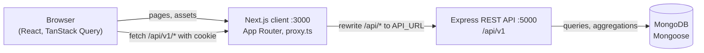

# Doctor Tracker

## Description

Doctor Tracker is a secure admin web application for managing doctors and their patients. An authenticated administrator can add doctors, search and filter them by name, specialization, hospital and creation date, open a doctor to see and manage their patients, and work with every patient on a dedicated page with search, condition, doctor and date filters. A dashboard turns the data into totals, patients per doctor, a per-day activity trend and a condition breakdown. It is built for speed and clarity: a Next.js client with a calm clinical interface, a standalone Express REST API, and MongoDB with compound, text and covered indexes plus aggregation pipelines, so lists, search, filters, pagination and charts stay fast as the data grows.

## Setup Guide

### Prerequisites

- **Node.js 20 or newer** (the repository pins 20 in `.nvmrc`; `nvm use` picks it up) and npm 10+
- **MongoDB 6 or newer**, either a local instance (`mongodb://127.0.0.1:27017`) or a free MongoDB Atlas cluster
- Git

### 1. Clone and install

```bash
git clone https://github.com/reduanahmadswe/DoctorTracker.git
cd DoctorTracker
npm install
```

The repository is an npm workspace with two separate apps: `client/` (Next.js) and `server/` (Express). One `npm install` at the root installs both.

### 2. Configure the environment

```bash
cp server/.env.example server/.env
cp client/.env.example client/.env.local
```

On Windows PowerShell use `Copy-Item` instead of `cp`.

**`server/.env`**

| Variable | Required | Description |
| --- | --- | --- |
| `NODE_ENV` | no | `development` (default), `production` or `test`. In `production` the auth cookie is marked `Secure` and error responses hide internals. |
| `PORT` | no | Port of the API. Defaults to `5000`. |
| `MONGODB_URI` | yes | MongoDB connection string, for example `mongodb://127.0.0.1:27017/doctor-tracker` or an Atlas `mongodb+srv://...` URI. |
| `JWT_SECRET` | yes | Secret that signs login tokens, at least 32 characters. Generate one with `node -e "console.log(require('crypto').randomBytes(48).toString('hex'))"`. Never commit it. |
| `JWT_EXPIRES_IN` | no | Lifetime of a login, such as `12h`, `1d` or `7d`. Defaults to `1d` and also sets the cookie lifetime. |
| `CLIENT_ORIGIN` | yes | Origin of the client app, for example `http://localhost:3000`. It is the only origin CORS allows. |
| `SEED_ADMIN_EMAIL` | yes | Email of the admin account created by the seed script. |
| `SEED_ADMIN_PASSWORD` | yes | Password of that admin account (at least 8 characters). |

The server validates these at startup and exits with a clear message if one is missing or invalid.

**`client/.env.local`**

| Variable | Required | Description |
| --- | --- | --- |
| `API_URL` | yes | Base URL of the Express API, for example `http://localhost:5000`. Next.js forwards `/api/*` requests to it, so the browser only ever talks to the client origin. |
| `NEXT_PUBLIC_DEMO_EMAIL` | no | Together with the next variable, shows a demo login box with a one-click fill button on the sign-in page. Leave both out in production. |
| `NEXT_PUBLIC_DEMO_PASSWORD` | no | Must match `SEED_ADMIN_PASSWORD` if you use the demo box. |

### 3. Create the admin account

```bash
npm run seed:admin
```

This creates the admin from `SEED_ADMIN_EMAIL` and `SEED_ADMIN_PASSWORD`. It is safe to run again: an existing admin is left untouched. There is no public sign-up page, so this is the only way to create an account.

Optionally add realistic demo data (12 doctors and about 100 patients spread over the last five months). It refuses to run in production and skips itself if doctors already exist:

```bash
npm run seed:demo
```

### 4. Run the apps

Open two terminals in the project root:

```bash
npm run dev:server
```

```bash
npm run dev:client
```

Then open <http://localhost:3000> and sign in with the values you set for `SEED_ADMIN_EMAIL` and `SEED_ADMIN_PASSWORD`. With the unchanged example files that is `admin@example.com` and `change-me-please`; change them before using the app for anything real.

### Useful commands

| Command | What it does |
| --- | --- |
| `npm run lint` | Lints both apps |
| `npm run typecheck` | Type-checks both apps (TypeScript strict) |
| `npm run build` | Builds both apps for production |
| `npm run start --workspace server` | Runs the built API (`node dist/server.js`) |
| `npm run start --workspace client` | Runs the built Next.js app |

## System Architecture



### Request flow

1. The browser loads pages from the Next.js client. Every data request is a relative `fetch("/api/v1/...")` to the **client origin**.
2. A rewrite in `client/next.config.ts` forwards `/api/*` to the Express server (`API_URL`). To the browser the API is same-origin, so the auth cookie is first-party and no cross-site cookie or CORS handling is needed in practice. Express still allows only `CLIENT_ORIGIN` through CORS.
3. Express runs a fixed pipeline: `helmet`, CORS, a 10 KB JSON body limit, `cookie-parser`, NoSQL-operator sanitizing, `hpp`, a per-IP rate limit, then the router. Each route is `route → controller → service → Mongoose model`; the controller only reads validated input and shapes the response, the service holds the query logic.
4. Every request is validated with zod before it reaches a service. Errors go through one handler and always have the same shape: `{ success: false, message, errors? }`; successes are `{ success: true, data, meta? }`.

### Authentication flow

1. `POST /api/v1/auth/login` checks the credentials (bcrypt, cost 12; the same generic error for an unknown email and a wrong password) and sets a signed JWT in an **httpOnly, SameSite=Lax cookie** named `token` (`Secure` in production). The login route is limited to 5 failed attempts per 15 minutes per IP.
2. `client/src/proxy.ts` (Next.js 16's middleware) redirects visitors without a `token` cookie to `/login?next=...`, and sends signed-in visitors away from `/login`. This is only an optimistic check on cookie presence.
3. The real check happens on the server: the dashboard layout asks `GET /auth/me` through TanStack Query and shows nothing until it succeeds. The `authenticate` middleware verifies the JWT and loads the user; `authorize("admin")` guards every non-auth route (401 when not signed in, 403 for a wrong role).
4. A 401 anywhere clears the stale cookie through `POST /auth/logout` and sends the user to `/login`. Logout clears the cookie and the query cache.

### REST API

| Method and path | Purpose |
| --- | --- |
| `POST /auth/login`, `POST /auth/logout`, `GET /auth/me` | Session |
| `POST /doctors`, `GET /doctors`, `GET /doctors/filters`, `GET /doctors/:id` | Create, list (search, specialization, hospital, date range, pagination), filter options, details |
| `GET /doctors/:id/patients`, `POST /doctors/:id/patients`, `DELETE /doctors/:id/patients/:patientId` | A doctor's patients |
| `GET /patients`, `PATCH /patients/:id`, `DELETE /patients/:id` | Patients page (search, condition, doctor, date range, pagination), edit, delete |
| `GET /dashboard/stats` | Totals, patients per doctor, patients by condition and per-day counts, in one response |
| `GET /health` | Liveness check |

All paths are under `/api/v1` and every route except `/auth/login`, `/auth/logout` and `/health` requires an authenticated admin.

### Folder structure

```text
.
├── client/                      Next.js (App Router, TypeScript, Tailwind)
│   └── src/
│       ├── app/                 routes: (auth)/login, (dashboard)/{dashboard,doctors,doctors/[id],patients}
│       ├── components/ui/       design-system components (Button, Table, Modal, Combobox, ...)
│       ├── components/layout/   Sidebar, Topbar, MobileNav, PageHeader
│       ├── features/            auth, doctors, patients, dashboard (api calls, hooks, components)
│       ├── lib/                 api-client, query-client, URL list state, formatting, constants
│       ├── types/               shared API response types
│       └── proxy.ts             optimistic route protection
├── server/                      Express (TypeScript)
│   └── src/
│       ├── config/              env.ts (zod-validated), db.ts (Mongoose connection)
│       ├── middlewares/         authenticate, authorize, validate, rate limiters, error handling
│       ├── modules/             auth, doctors, patients, dashboard (routes, controller, service, schemas, model)
│       ├── routes/              mounts /api/v1
│       ├── scripts/             seedAdmin, seedDemo
│       ├── utils/               ApiError, response helpers, pagination, date ranges, shared validators
│       ├── app.ts               Express app (no listen)
│       └── server.ts            connects the database, listens, shuts down gracefully
└── package.json                 npm workspaces and root scripts
```

## Technical Decisions

### 1. TanStack Query and URL search params instead of Redux or Context

**The problem.** Almost all state in this app is *server state*: lists of doctors and patients, a doctor's profile, dashboard numbers. The rest is *view state* of a list: the search text, the filters and the current page. A global store such as Redux, or a hand-rolled Context, would have to re-implement loading and error flags, caching, refetching, request cancellation and invalidation for the first kind, and would hide the second kind in memory where it cannot be shared or restored.

**What the app does instead.**

- **Server state lives in TanStack Query.** Every list, detail and statistic is a query whose key contains its parameters (`["doctors", "list", filters]`), so each combination is cached independently. `staleTime` is 30 seconds, refetch on window focus is off for lists, and 4xx responses are never retried.
- **Pagination feels instant.** Lists use `placeholderData: keepPreviousData`: while page 2 loads, page 1 stays on screen slightly dimmed (`aria-busy`) instead of flashing a skeleton, and going back to a page that was already visited is served from the cache.
- **View state lives in the URL.** Search, filters and page are search params (`/patients?condition=Critical&doctor=...&page=2`). A shared hook, `useListParams`, reads them, exposes stable handlers and resets the page to 1 whenever a filter changes. Any view can therefore be bookmarked or sent to a colleague, refresh and the browser's back button restore it exactly, and the "Back to doctors" link on a doctor's page returns to the same filtered, paginated list.
- **Mutations keep the cache honest.** Creating, editing or deleting records invalidates only what depends on them (the lists, the affected doctor, the dashboard). Deleting a patient is optimistic: the row disappears at once and is restored with an error toast if the server refuses.
- **Fewer re-renders.** Because the data sits in the query cache and the filters in the URL, only the components that read them re-render. Table rows, cards and toolbars are `memo`ized with stable callbacks, so a background refetch does not re-render the toolbar, and typing in the search box (debounced 300 ms) does not re-render the table.

**Trade-offs.** TanStack Query adds a dependency and a mental model (keys, invalidation), which is far less code and fewer bugs than a store that reimplements it. Anything genuinely client-only and local, such as whether a dialog is open, stays plain `useState` next to the component that owns it. The app has no global client state at all.

### 2. Compound, text and covered indexes plus aggregation pipelines for search, filters, pagination and the dashboard

**The problem.** Every list has the same shape: optional text search, optional equality filters, an optional date range, newest first, paginated, with a total count. Done naively, each request scans the whole collection, and the dashboard would load every patient into memory just to count them.

**What the app does.**

- **Indexes follow the query shapes.** Doctors: `{createdAt: -1}`, `{specialization: 1, createdAt: -1}`, `{hospital: 1, createdAt: -1}`, a unique `{email: 1}` and a weighted text index (name 10, specialization 5, hospital 3, email 1). Patients: `{createdAt: -1}`, `{doctor: 1, createdAt: -1}`, `{condition: 1, createdAt: -1}` and a text index on name and phone. Putting `createdAt` second lets MongoDB filter on the equality field and return rows already sorted, so there is no in-memory sort.
- **One filter object, `lean()`, parallel count.** Each list builds its filter once, uses `.lean()` with only the needed fields, and runs `find` and `countDocuments` with `Promise.all`. Search uses `$text` and sorts by text score first.
- **No N+1.** Patient counts for a page of doctors come from a single `$group` aggregation, and the patients list adds doctor names with one extra query by `_id`.
- **The dashboard is aggregation pipelines.** Per-day counts are a `$match` on the indexed `createdAt` followed by a `$group` by UTC day. The patients-per-doctor and per-condition breakdowns group on indexed fields and are hinted to those indexes, so they are answered from the index alone (covered) without reading documents. They are separate pipelines rather than one `$facet`, because a `$facet` forced a collection scan. The `$lookup` that adds doctor names runs only on the 10 grouped rows. Indexes are built before the server starts accepting requests.

**Evidence.** `explain("executionStats")` on a database with 14 doctors and 110 patients. No query does a collection scan.

| Query | Plan and index | Keys / documents examined |
| --- | --- | --- |
| Doctors: default list | `IXSCAN createdAt_-1` | 10 / 10 |
| Doctors: by specialization | `IXSCAN specialization_1_createdAt_-1` | 3 / 3 |
| Doctors: by hospital | `IXSCAN hospital_1_createdAt_-1` | 5 / 5 |
| Doctors: date range | `IXSCAN createdAt_-1` | 8 / 8 |
| Doctors: text search | `IXSCAN doctor_text_search` | 2 / 2 |
| Doctors: filter dropdown values | `DISTINCT_SCAN` (covered) | 6 / 0 |
| Doctors: lookup by email or id | `email_1`, `_id_` | 1 / 1 |
| Patients: default list, date range | `IXSCAN createdAt_-1` | 10 / 10 |
| Patients: by condition | `IXSCAN condition_1_createdAt_-1` | 10 / 10 |
| Patients: by doctor | `IXSCAN doctor_1_createdAt_-1` | 10 / 10 |
| Patients: doctor + condition | `IXSCAN doctor_1_createdAt_-1` | 12 / 12 |
| Patients: text search | `IXSCAN patient_text_search` | 12 / 12 |
| Patient counts for the doctors list | `IXSCAN doctor_1_createdAt_-1` (covered) | 12 / 0 |
| Dashboard: patients per doctor | `IXSCAN doctor_1_createdAt_-1` (covered, hinted) | 110 / 0 |
| Dashboard: patients by condition | `IXSCAN condition_1_createdAt_-1` (covered, hinted) | 110 / 0 |
| Dashboard: new patients and doctors per day | `IXSCAN createdAt_-1` (covered) | 102 / 0 and 8 / 0 |
| Count behind each list's pagination total | `COUNT_SCAN` or the same index as the list | about 0 documents |

Before the hint was added, the two dashboard breakdowns did a collection scan of all 110 patients; afterwards they read no documents at all.

**Trade-offs.** Each index costs write time and storage, which is acceptable for read-heavy admin data. MongoDB text search matches whole words, so `neurology` finds Neurology but `neuro` does not; that is the price of using the text index the specification asks for instead of unindexed regular expressions. The dashboard breakdowns are hinted to named indexes, which is why indexes are built at startup.

### Minimal choices made while building

The specification was followed as written. Where it left room, the smallest option that satisfies it was chosen:

- **Patient fields** are exactly what the required filters need: name, phone, condition, doctor (a reference), `createdAt` and `updatedAt`. Conditions are the fixed set Stable, Under Observation, Critical and Recovered.
- **Doctor fields** are the five required ones (name, specialization, hospital, phone, email), all required; email is unique and stored lowercase. A doctor cannot be edited or deleted, as specified.
- **Authentication** has one role, `admin`, created only by the seed script. There is no sign-up page. Tokens are stateless, so logout clears the cookie rather than revoking the token.
- **Date filters** compare `createdAt` with inclusive UTC day bounds. The dashboard also buckets days in UTC, so the two always agree.
- **Dashboard scope:** the totals, patients per doctor (top 10) and condition breakdown describe all data; only the activity chart follows the selected range (default last 30 days, at most 366).
- **Doctor pickers** (the patient filter and the edit form) load the first 50 doctors, the API's page-size cap, and filter them in the browser.
- **Cache Components** are switched off in `next.config.ts`. The app fetches everything on the client, and the feature caused false hydration and prefetch-validation errors in development.
- **Demo credentials box** on the sign-in page is optional, was requested after the specification, and appears only when both `NEXT_PUBLIC_DEMO_*` variables are set.
- **Rate limits:** 5 failed logins per 15 minutes per IP, and 600 API requests per 15 minutes per IP. Behind a reverse proxy, set Express's `trust proxy` so the real client IP is used; this is not configured by default.
